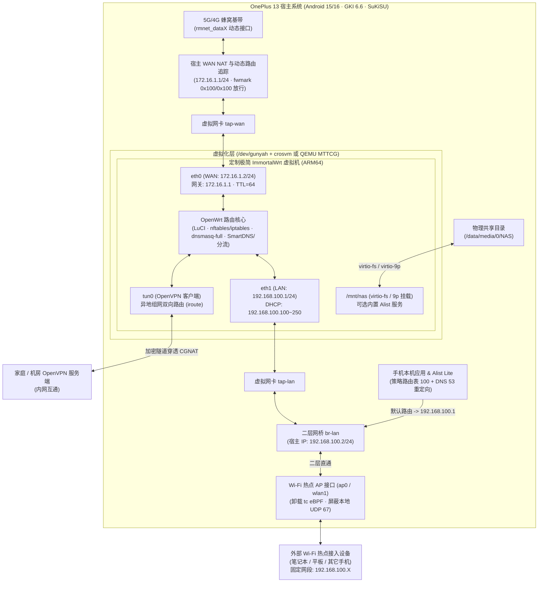

# x-route 系统架构与工程实现规范 (System Architecture)

---

## 一、 全景网络与系统拓扑



---

## 二、 核心网络平面设计

### 2.1 地址规划表

| 接口 / 平面 | 所属位置 | 网络接口名 | IPv4 地址 / 网段 | 职责说明 |
| :--- | :--- | :--- | :--- | :--- |
| **物理出接口** | Android 宿主 | `rmnet_data0` ~ `rmnet_data7` | 运营商 CGNAT 动态分配 | 5G/4G 移动数据流量物理出口 |
| **WAN 互联宿主侧** | Android 宿主 | `tap-wan` | `172.16.1.1/24` | 连接宿主机与 OpenWrt WAN 口的点对点虚拟通道 |
| **WAN 口虚拟机侧** | OpenWrt VM | `eth0` (`virtio-net`) | `172.16.1.2/24`（网关 `172.16.1.1`） | OpenWrt 外部出口，统一执行 MASQUERADE 与 `TTL=64` |
| **LAN 口虚拟机侧** | OpenWrt VM | `eth1` (`virtio-net`) | **`192.168.100.1/24`** | **核心固定网关**，提供 LuCI 后台、DHCP（`.100`~`.250`）与 DNS 服务 |
| **LAN 二层网桥** | Android 宿主 | `br-lan`（含 `tap-lan` + `$AP_IF`） | **`192.168.100.2/24`** | 桥接热点无线接口与虚拟机 LAN 口，同时作为宿主机回流源接口 |
| **异地组网隧道** | OpenWrt VM | `tun0` | 由 `.ovpn` 服务端分配 | 打通家庭/机房内网与 `192.168.100.0/24` 双向互访 |

---

### 2.2 热点动态无感接管流程 (`net_orchestrator.sh`)

```mermaid
sequenceDiagram
    participant User as 用户 / Android 设置
    participantTether as Android Tethering / hostapd
    participant Watcher as x-route Netlink 守护进程
    participant Bridge as 宿主 br-lan & 防火墙
    participant Wrt as OpenWrt (192.168.100.1)

    User->>participantTether: 开启“个人热点”
    participantTether->>Watcher: 内核触发 RTM_NEWLINK (ap0 / wlan1 UP)
    Watcher->>Watcher: iw dev 确认为 type AP 接口 ($AP_IF)
    Watcher->>Bridge: 1. tc qdisc del dev $AP_IF clsact (移除 eBPF 卸载)
    Watcher->>Bridge: 2. 拦截 $AP_IF 入向发往宿主本机的 UDP 67 (屏蔽系统内置 DhcpServer)
    Watcher->>Bridge: 3. ip addr flush dev $AP_IF && ip link set $AP_IF master br-lan
    Bridge->>Wrt: 二层广播直通 tap-lan -> eth1
    Wrt-->>User: 外部设备获配 192.168.100.X，网关/DNS 指向 192.168.100.1
```

---

### 2.3 手机本机流量防环路回流设计

为确保手机自身 App 流量进入 OpenWrt (`192.168.100.1`) 且不与 `crosvm`/`qemu` 的 WAN 出站流量及系统直连路由发生环路：

1. **宿主机出站流量打标（豁免虚拟机与系统底层进程）**：
   - 虚拟机进程运行在专属 GID（如 `3009`）或通过 `iptables -t mangle -A OUTPUT` 将源 IP 为 `172.16.1.2` / 属于 VMM 进程的流量打上标记 `0x100/0x100`；
   - `tap-wan` 转发进入 `rmnet_dataX` 的流量在 `PREROUTING` 打上 `0x100/0x100`。
2. **多表策略路由优先级编排**：
   - `pref 4900`：保留 `local` 表与直连子网路由（`ip rule add pref 4900 table main suppress_prefixlength 0`），确保访问 `192.168.100.0/24`、`172.16.1.0/24` 不走默认网关；
   - `pref 5000`：放行带 `fwmark 0x100/0x100` 的流量走 Android 原生蜂窝路由表；
   - `pref 5100`：其余本机应用流量查表 `100`（`default via 192.168.100.1 dev br-lan src 192.168.100.2`）。
3. **本机 DNS 防泄漏**：
   - 自动记录原 `private_dns_mode` 值并设置 `settings put global private_dns_mode off`（模块停用时自动还原）；
   - `iptables -t nat -A OUTPUT -p udp --dport 53 ! -m mark --mark 0x100/0x100 -j DNAT --to-destination 192.168.100.1:53`。

---

## 三、 ImmortalWrt 极简固件编译规范

### 3.1 Target 与内核必选配置
- **源码基线**：`immortalwrt/immortalwrt` (`openwrt-23.05` 或 `openwrt-24.10` 分支)
- **Target System**：`ARM SystemReady (UEFI) compliant` (`CONFIG_TARGET_armsr=y`)
- **Subtarget**：`ARMv8 (64-bit)` (`CONFIG_TARGET_armsr_armv8=y`)
- **Gunyah pVM 与虚拟化内核配置（核心防崩项）**：
  ```ini
  CONFIG_SWIOTLB=y
  CONFIG_DMA_RESTRICTED_POOL=y
  CONFIG_VIRTIO=y
  CONFIG_VIRTIO_PCI=y
  CONFIG_VIRTIO_MMIO=y
  CONFIG_VIRTIO_BLK=y
  CONFIG_VIRTIO_NET=y
  CONFIG_VIRTIO_CONSOLE=y
  CONFIG_VIRTIO_BALLOON=y
  CONFIG_NET_9P=y
  CONFIG_NET_9P_VIRTIO=y
  CONFIG_9P_FS=y
  CONFIG_FUSE_FS=y
  CONFIG_VIRTIO_FS=y
  ```

### 3.2 预装与剔除软件包策略
- **必选集成包**：
  - 基础与防火墙：`base-files`, `dnsmasq-full`, `firewall4`, `nftables`, `iptables-nft`, `ip6tables-nft`, `kmod-nft-nat`, `kmod-ipt-ipopt`（用于 TTL 修改）
  - Web 管理：`luci`, `luci-ssl`, `luci-compat`, `luci-i18n-base-zh-cn`, `luci-i18n-firewall-zh-cn`, `opkg`, `ca-bundle`, `curl`
  - 组网与存储共享：`openvpn-openssl`, `luci-app-openvpn`, `luci-i18n-openvpn-zh-cn`, `alist`, `luci-app-alist`, `luci-i18n-alist-zh-cn`
- **强制剔除包**：
  - 剔除所有物理无线驱动（`kmod-mt76*`, `kmod-ath*`, `kmod-rtw*`, `wpad*`, `hostapd*`）
  - 剔除所有物理 USB/PCIe 网卡与声卡驱动（`kmod-usb*`, `kmod-r8169`, `kmod-e1000*`, `kmod-sound*`）
  - 剔除宽带拨号组件（`ppp`, `ppp-mod-pppoe`）

---

## 四、 SuKiSU 模块目录与四重保活规范

### 4.1 模块文件结构
```text
module/
├── module.prop                  # 模块元信息 (id=x_route)
├── customize.sh                 # 刷入时环境检测 (/dev/gunyah, crosvm, 权限设置)
├── service.sh                   # late_start 后台守护入口
├── action.sh                    # SuKiSU 管理器一键启停/状态切换脚本
├── uninstall.sh                 # 卸载时清理虚拟磁盘与还原系统设置
├── config/
│   └── config.json              # WebUI 与守护进程共享配置 (保活包名列表、NAS路径、回流开关)
├── scripts/
│   ├── vm_manager.sh            # crosvm (Gunyah) / QEMU 启动与监控
│   ├── net_orchestrator.sh      # WAN NAT、热点动态桥接、本机策略路由回流
│   └── keepalive_daemon.sh      # 四重内核级保活与充电保护循环
└── webroot/
    ├── index.html               # SuKiSU 模块原生 WebUI 面板
    ├── app.js                   # 基于 window.ksu.exec 的前后端通信逻辑
    └── style.css                # 响应式深色/浅色自适应样式
```

### 4.2 四重内核级保活引擎执行规范 (`keepalive_daemon.sh`)
针对 `config.json` 中配置的包名列表（默认含 `com.leohao.android.alistlite`）：
1. **第一重（系统策略与电源豁免）**：
   - `dumpsys deviceidle whitelist +<pkg>`
   - `cmd netpolicy add restrict-background-whitelist <uid>`
   - `cmd appops set <pkg> RUN_IN_BACKGROUND allow`
   - `cmd appops set <pkg> RUN_ANY_IN_BACKGROUND allow`
   - `device_config put activity_manager max_phantom_processes 2147483647`
2. **第二重（Linux OOM 豁免）**：
   - 对主进程及所有子进程写入 `echo -1000 > /proc/$PID/oom_score_adj`
3. **第三重（Cgroup v2 与 ColorOS Hans 反冻结）**：
   - 检查 `/sys/fs/cgroup/uid_${UID}/pid_${PID}/cgroup.freeze`，若为 `1` 立即置 `0`；
   - 将 `$PID` 迁移至根 `/sys/fs/cgroup/cgroup.procs` 并发送 `kill -SIGCONT $PID`
4. **第四重（进程看门狗自愈）**：
   - 轮询检测 `pidof <pkg>`，若进程意外退出，自动通过 `am startservice` / `monkey -p <pkg> -c android.intent.category.LAUNCHER 1` 静默拉起。
